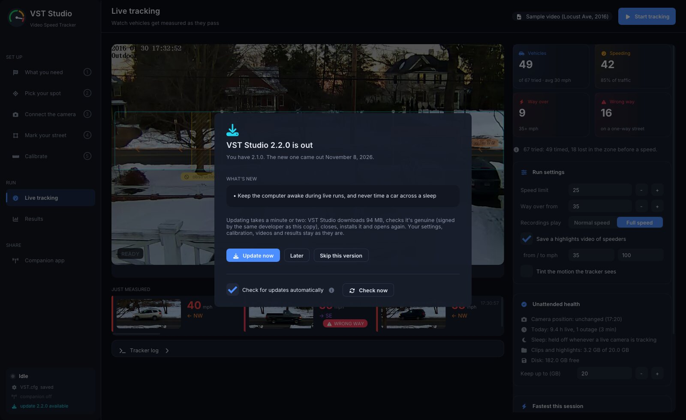

# Installing VST Studio

Every [release](https://github.com/joekiller/VSTStudio/releases/latest) has a package for each platform. Each
package holds the whole project: **VST Studio** (the desktop app most people use), the phone companion it serves, the
command-line tracker `VideoSpeedTracker`, the highlights editor `ProcessHiLites`, a sample video and its settings, and
the guides. Nothing else needs installing.

## Pick your download

| Your computer | Download | How to install |
|---|---|---|
| **Windows** 10 or 11 (64-bit) | `VSTStudio-<version>-windows-x64-setup.exe` | Run it. The first page asks whether to install just for you (no admin prompt) or for everyone on the computer; *for everyone* also lets phones reach the companion through Windows Firewall on your home network. VST Studio is added to the Start menu, and it uninstalls from **Settings > Apps**. |
| Windows, no installer | `VSTStudio-<version>-windows-x64.zip` | Unzip anywhere and run `VSTStudio.exe`. |
| **Mac** with Apple silicon (M1 or later), macOS 13 or later | `VSTStudio-<version>-macos-arm64.dmg` | Open it and drag **VSTStudio.app** onto Applications. That one app is everything, the command-line tools included ([below](#macos-command-line-tools)). |
| Mac, archive | `VSTStudio-<version>-macos-arm64.tar.gz` | The same app: untar it and move **VSTStudio.app** to Applications. |
| **Linux** and **Raspberry Pi**: Debian 12 or 13, Raspberry Pi OS (64-bit), Ubuntu 24.04 or 26.04 | `vststudio_<version>_<distro>_<amd64 or arm64>.deb` | `sudo apt install ./vststudio_*.deb`. Use `arm64` for a Raspberry Pi and `amd64` for most PCs. apt pulls in FFmpeg and GTK; OpenCV is built in. |

Your settings and results are kept outside the program folder, so upgrading or uninstalling never touches them.

Then open **VST Studio** (Start menu, Applications, or your Linux applications menu; `VSTStudio` from a terminal) and
follow [Getting started](getting-started.md).

## Updates

VST Studio checks for a new release once a day and asks before changing anything. When one is out, the **VST Studio
updates** window shows what's new with three choices: **Update now**, **Later** (it asks again next time you open VST
Studio) and **Skip this version** (it waits for the one after). It never opens while a tracking run is going, and
**Update now** is greyed out until the run is stopped, so a camera watching the street is never cut off.



**Update now** downloads the new version, checks it (below), closes VST Studio, installs the new version and opens it
again, usually in a minute or two. There's nothing else to click, except that Windows asks for permission (the UAC
prompt) when VST Studio was installed *for everyone*. Settings, calibration, videos and results are kept outside the
program folder and aren't touched.

The bottom line of the side rail shows the version you have; click it to check now or to turn automatic checks off
(**Check for updates automatically**). With it off, VST Studio contacts GitHub only when you press **Check now**. A
check asks GitHub's public API for the latest release and sends nothing but VST Studio's version.

Where updates install themselves, and where they don't:

| Your copy | Updates |
|---|---|
| Windows, from the setup program | Installs itself, in the same folder, for the same users (just you, or everyone). |
| Windows, from the zip | Tells you about the new version and opens the download page. Install with the setup program to get automatic updates. |
| Mac, in **Applications** (or any folder you can change) | Installs itself in place. |
| Mac, opened straight from the disk image or Downloads | Asks you to drag **VSTStudio.app** to Applications first. |
| Linux and Raspberry Pi | Tells you about the new version; install its `.deb` as before. |
| Built from source, or from a pull request | Doesn't check: only signed releases update. |

Before anything is installed, VST Studio checks the download two ways and stops at the first that fails: its sha256
must match both GitHub's record for that file and the release's `SHA256SUMS`, and the operating system must confirm it
is signed by the same developer as the copy that's running (Windows: the same Authenticode publisher, through a
trusted certificate chain; Mac: the same Apple Developer ID team and app, notarized by Apple). A file that fails is
deleted and nothing changes. Automatic updates start with the first release after 2.2.0; a copy of 2.2.0 or older needs one last download by hand.

## Is the download genuine?

Release packages are signed so you can tell they came from this project and weren't changed on the way:

- **Windows:** the programs and installer carry a Microsoft-issued code signature, so Windows shows the publisher
  instead of "unknown publisher".
- **macOS:** the app and disk image are signed with an Apple Developer ID and notarized by Apple, so they open
  without warnings.
- **Every file, every platform:** GitHub records an [artifact attestation](https://docs.github.com/en/actions/security-for-github-actions/using-artifact-attestations)
  when the release is built. It proves the file's exact bytes came from this repository's release workflow, on
  GitHub's own machines, from the tagged source. It is the Linux packages' signature: apt checks signatures on
  repositories, not on a `.deb` installed from a file.

To check an attestation yourself with the [GitHub CLI](https://cli.github.com/), pinning the workflow and the tag so a
file built any other way fails:

```
gh attestation verify vststudio_2.0.0_ubuntu-24.04_arm64.deb -R joekiller/VSTStudio \
  --signer-workflow joekiller/VSTStudio/.github/workflows/release.yml \
  --source-ref refs/tags/v2.0.0 --deny-self-hosted-runners
```

Releases before v2.0.0 were built when the repository was called VideoSpeedTracker, so their attestations name it:
for those, use `joekiller/VideoSpeedTracker` in `-R` and `--signer-workflow`.

Each release also has `SHA256SUMS`, listing every file, which is itself attested, so one check covers a whole
download folder. `SHA256SUMS.sigstore.json` is that signature as a file, for checking later or offline:

```
gh attestation verify SHA256SUMS --bundle SHA256SUMS.sigstore.json -R joekiller/VSTStudio \
  --signer-workflow joekiller/VSTStudio/.github/workflows/release.yml --source-ref refs/tags/v2.0.0
sha256sum -c SHA256SUMS --ignore-missing        # macOS: shasum -a 256 -c SHA256SUMS --ignore-missing
```

On a Mac, in the opened disk image or the untarred folder:

```
spctl -a -t open --context context:primary-signature -vv VSTStudio-*.dmg   # the image: Notarized Developer ID
codesign -dv --verbose=4 VSTStudio.app      # Authority=Developer ID Application: ..., Runtime Version, Timestamp
spctl -a -t exec -vv VSTStudio.app          # accepted, source=Notarized Developer ID
xcrun stapler validate VSTStudio.app        # The validate action worked!
```

Builds that aren't from a release tag (from `main`, a pull request or a fork) are not signed. macOS refuses them
until you clear the quarantine flag: `xattr -dr com.apple.quarantine VSTStudio.app`. How signing is set up for
maintainers is in [code-signing.md](code-signing.md).

## Where settings and data live

| | Settings (`VST.cfg`, `vst-studio.ini`, calibration records) | Data (videos, results, reports, archives) |
|---|---|---|
| Windows | `%APPDATA%\VSTStudio` | `%LOCALAPPDATA%\VSTStudio` |
| macOS | `~/Library/Application Support/VSTStudio` | `~/Library/Application Support/VSTStudio/Data` |
| Linux | `~/.config/vststudio` (or `$XDG_CONFIG_HOME`) | `~/.local/share/vststudio` (or `$XDG_DATA_HOME`) |

Upgrading from v1 (when VST Studio was called VideoSpeedTracker): if the folders above don't exist yet but the v1
ones do (`VideoSpeedTracker` on Windows and macOS, `videospeedtracker` on Linux), VST Studio keeps using the v1
folders as they are, with every setting, calibration and run in them. Nothing is moved or copied. To switch to the
new name, quit VST Studio and rename the folders yourself; set `dataPathPrefix` in `VST.cfg` to match if it names
the old data folder.

The first time a program runs it copies its settings template here and creates the data folders. The program's own
folder is never written to. To keep video and results on another drive, set `dataPathPrefix` in `VST.cfg` (see the
[configuration reference](config-reference.md#files)).

The command-line programs pick their settings in this order: a file given with `--config`, else a `VST.cfg` in the
folder you run them from, else the per-user copy above. Each prints `Using config <path>` so you always know which.
What is in each folder is described in [Output files](output-files.md).

## macOS command-line tools

The Mac download is a single `VSTStudio.app`. The command-line programs and their files are inside it (Finder:
right-click the app, **Show Package Contents**):

| | |
|---|---|
| `Contents/MacOS/` | `VideoSpeedTracker`, `ProcessHiLites` and `VSTStudio` itself |
| `Contents/Frameworks/` | the FFmpeg libraries they load |
| `Contents/Resources/` | the `VST.cfg` and `ProcessHiLites.cfg` templates, `README.md` and `GETTING-STARTED.md`, licenses, the sample video and the phone companion |

To run them by name, link them into a folder on your `PATH`:

```
sudo mkdir -p /usr/local/bin
sudo ln -sf /Applications/VSTStudio.app/Contents/MacOS/{VideoSpeedTracker,ProcessHiLites} /usr/local/bin/
VideoSpeedTracker --demo
```

Don't edit the templates inside the app: that breaks its signature, and an update replaces them anyway. Edit the
per-user copy in `~/Library/Application Support/VSTStudio` instead.

On Windows the command-line programs are in the install folder: `%LOCALAPPDATA%\Programs\VSTStudio` when
installed for you, or `C:\Program Files\VSTStudio` for everyone (an install upgraded from v1 stays in its
`VideoSpeedTracker` folder). On Linux they are on your `PATH`.

## Licenses

VST Studio is BSD 3-Clause ([LICENSE](../LICENSE)), copyright Paul Reynolds, 2016, whose VideoSpeedTracker it is
built on, with every later contribution under the same terms. Every package links OpenCV (Apache 2.0) statically. The Windows packages ship
OpenCV's FFmpeg plugin and the Mac app ships FFmpeg libraries (both LGPL 2.1, loaded dynamically); Linux gets FFmpeg
and GTK from apt. VST Studio also builds in GLFW, Dear ImGui, cpp-httplib, nlohmann/json, Nayuki's QR Code generator,
and the Inter and Font Awesome Free fonts. Their license texts are installed in `licenses/` (Windows),
`VSTStudio.app/Contents/Resources/licenses/` (macOS) or `/usr/share/doc/vststudio/` (Linux).
